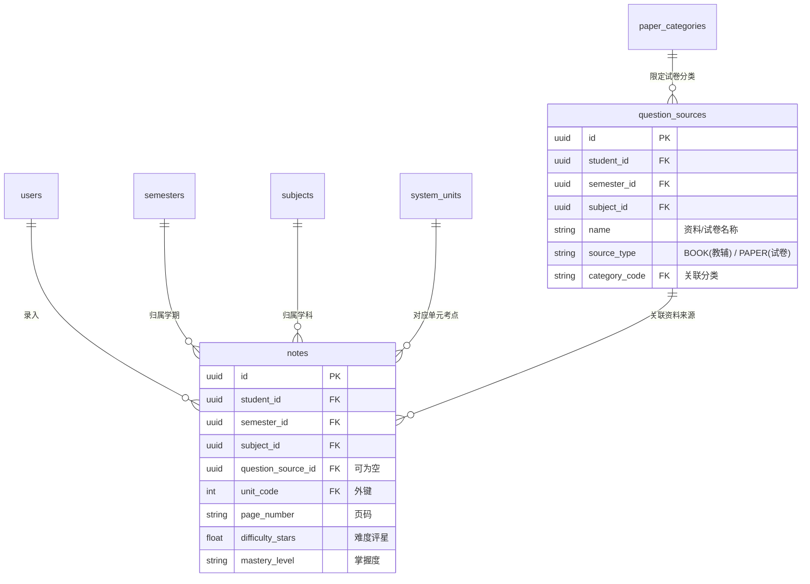

# 习题、来源及大纲单元重构设计规范 (Web + Android 双端标准)

为了支持 SproutMemo (知拾) 的 Web 端与 Android 移动端的多端协同，本规范确立了“**零配置即时录入**”与“**强数据库维度约束**”相结合的设计规范。此设计旨在消灭用户自由输入带来的错别字与命名异形，保证错题本能进行跨卷、跨册的**精确单元级筛选复习**。

---

## 一、 数据库架构设计 (Database Architecture)

系统取消所有自由文本单元名称与松散来源分类，转为由关系型数据库实体表与物理外键维护的标准化结构。

### 1. 关系图 (ER Diagram)



### 2. 核心数据表结构与字段定义

#### 表 A: 系统通用大纲单元表 (`system_units`)
用于解决**数字单元**与**综合性考试阶段（期中、期末、未分类）**的冲突。由后台种子数据一次性生成，不需家长手动维护。
*   **主键设计**：直接采用易读的整数（`1 ~ 999`）作为 PK。

| 字段名 | 类型 | 约束 | 默认值 | 说明 |
| :--- | :--- | :--- | :--- | :--- |
| `id` | `INTEGER` | `PRIMARY KEY` | - | 单元编码（如 1、2... 101, 102） |
| `name` | `VARCHAR(50)` | `NOT NULL` | - | 展示名称（如 "第 1 单元", "期中综合/复习"） |
| `unit_type` | `VARCHAR(20)` | `NOT NULL` | - | 类型：`NUMBER` (数字), `COMPREHENSIVE` (综合), `FALLBACK` (托底) |
| `sort_order` | `INTEGER` | `NOT NULL` | `0` | 全局展示排序权重 |

#### 表 B: 试卷/资料分类维度表 (`paper_categories`)
规范试卷、日常作业的性质属性，确保各端统计分类 100% 对齐。
*   **主键设计**：采用语义化字符串代码（如 `MIDTERM`）。

| 字段名 | 类型 | 约束 | 默认值 | 说明 |
| :--- | :--- | :--- | :--- | :--- |
| `code` | `VARCHAR(30)` | `PRIMARY KEY` | - | 分类代码（如 `MIDTERM`, `FINAL`, `DAILY_HW`） |
| `name` | `VARCHAR(50)` | `NOT NULL` | - | 展示名字（如 "期中考试", "日常作业/练习"） |
| `sort_order` | `INTEGER` | `NOT NULL` | `0` | 排序权重 |

#### 表 C: 资料来源表 (`question_sources`)
*   **变更**：废弃原 free-text 的 `category` 字段，改为 `category_code` 关联 `paper_categories.code` 的外键。

#### 表 D: 习题笔记表 (`notes`)
*   **变更**：废弃纯手写 `unit_name`，改为 `unit_code` 字段，且建立物理外键关联 `system_units.id`。

---

## 二、 核心数据库数据实例 (Data Examples)

为了方便理解，以下展示一组真实录题场景下的数据表数据快照：

### 1. `system_units` (单元维度表) 预置数据例子
```sql
-- 数据库初始化时自动插入的静态行
INSERT INTO system_units (id, name, unit_type, sort_order) VALUES
(1, '第 1 单元', 'NUMBER', 10),
(2, '第 2 单元', 'NUMBER', 20),
(3, '第 3 单元', 'NUMBER', 30),
(4, '第 4 单元', 'NUMBER', 40),
(101, '期中综合/复习', 'COMPREHENSIVE', 130),
(102, '期末综合/复习', 'COMPREHENSIVE', 140),
(999, '综合/未分类', 'FALLBACK', 999);
```

### 2. `paper_categories` (试卷分类表) 预置数据例子
```sql
INSERT INTO paper_categories (code, name, sort_order) VALUES
('DAILY_HW', '日常作业/课后练习', 10),
('UNIT_TEST', '单元测试/周测', 20),
('MIDTERM', '期中考试', 30),
('FINAL', '期末考试', 40),
('OTHER', '其他综合', 50);
```

### 3. `question_sources` (资料来源表) 数据例子
```sql
-- 自动或手动录入生成的教辅和试卷实体记录
INSERT INTO question_sources (id, student_id, semester_id, subject_id, name, source_type, category_code) VALUES
-- 家长提前维护好的教辅书
('uuid-book-01', 'uuid-student-tom', 'uuid-sem-3down', 'uuid-sub-math', '《数学黄冈小状元》', 'BOOK', 'DAILY_HW'),
-- 录题时自动静默生成的试卷
('uuid-paper-02', 'uuid-student-tom', 'uuid-sem-3down', 'uuid-sub-math', '“1-2单元综合测试卷”', 'PAPER', 'UNIT_TEST'),
('uuid-paper-03', 'uuid-student-tom', 'uuid-sem-3down', 'uuid-sub-math', '“2026学年期中考试真题卷”', 'PAPER', 'MIDTERM');
```

### 4. `notes` (习题表) 关联数据例子
```sql
-- 错题记录快照，展示如何通过外键组合进行精确定类
INSERT INTO notes (id, student_id, semester_id, subject_id, question_source_id, unit_code, page_number) VALUES
-- 例 1：出自教辅书，明确属于第 2 单元，第 15 页
('note-001', 'uuid-student-tom', 'uuid-sem-3down', 'uuid-sub-math', 'uuid-book-01', 2, '第 15 页'),
-- 例 2：出自1-2单元综合练习卷中的第 1 题（属于第 1 单元）
('note-002', 'uuid-student-tom', 'uuid-sem-3down', 'uuid-sub-math', 'uuid-paper-02', 1, '第 1 页'),
-- 例 3：出自期中真题卷，属于跨单元的期中综合题
('note-003', 'uuid-student-tom', 'uuid-sem-3down', 'uuid-sub-math', 'uuid-paper-03', 101, '第 3 页'),
-- 例 4：出自期中真题卷，但考点模糊、无法归入特定单元（使用 999 托底）
('note-004', 'uuid-student-tom', 'uuid-sem-3down', 'uuid-sub-math', 'uuid-paper-03', 999, '第 5 页');
```

---

## 三、 数据初始化与软件启动 Seeding 逻辑

为满足 Web+Android 端部署后“开箱即用”的要求，后端程序必须在**启动事件挂钩 (Startup Event)** 中实现对维度维度表 `system_units` 和 `paper_categories` 的静默填充。

### 1. 软件初始化代码修改位置
在后端入口文件 [app/main.py](file:///e:/home/lyc/Documents/code/SproutMemo/sproutmemo-api/app/main.py) 中，对 `@app.on_event("startup")` 进行扩充，使其在启动时自动执行种子数据校验：

```python
# app/main.py (新增与修改部分示意)

def seed_system_metadata(db):
    """系统启动时，自动填充大纲单元及试卷分类静态维度表"""
    # 1. 自动注入系统通用大纲单元 (system_units)
    units_to_seed = [
        {"id": 1, "name": "第 1 单元", "unit_type": "NUMBER", "sort_order": 10},
        {"id": 2, "name": "第 2 单元", "unit_type": "NUMBER", "sort_order": 20},
        {"id": 3, "name": "第 3 单元", "unit_type": "NUMBER", "sort_order": 30},
        {"id": 4, "name": "第 4 单元", "unit_type": "NUMBER", "sort_order": 40},
        {"id": 5, "name": "第 5 单元", "unit_type": "NUMBER", "sort_order": 50},
        {"id": 6, "name": "第 6 单元", "unit_type": "NUMBER", "sort_order": 60},
        {"id": 7, "name": "第 7 单元", "unit_type": "NUMBER", "sort_order": 70},
        {"id": 8, "name": "第 8 单元", "unit_type": "NUMBER", "sort_order": 80},
        {"id": 9, "name": "第 9 单元", "unit_type": "NUMBER", "sort_order": 90},
        {"id": 10, "name": "第 10 单元", "unit_type": "NUMBER", "sort_order": 100},
        {"id": 11, "name": "第 11 单元", "unit_type": "NUMBER", "sort_order": 110},
        {"id": 12, "name": "第 12 单元", "unit_type": "NUMBER", "sort_order": 120},
        {"id": 101, "name": "期中综合/复习", "unit_type": "COMPREHENSIVE", "sort_order": 130},
        {"id": 102, "name": "期末综合/复习", "unit_type": "COMPREHENSIVE", "sort_order": 140},
        {"id": 999, "name": "综合/未分类", "unit_type": "FALLBACK", "sort_order": 999},
    ]
    for u in units_to_seed:
        exists = db.query(SystemUnit).filter(SystemUnit.id == u["id"]).first()
        if not exists:
            db.add(SystemUnit(**u))
            logger.info(f"Seeded system unit: {u['name']}")

    # 2. 自动注入试卷分类大纲 (paper_categories)
    categories_to_seed = [
        {"code": "DAILY_HW", "name": "日常作业/课后练习", "sort_order": 10},
        {"code": "UNIT_TEST", "name": "单元测试/周测", "sort_order": 20},
        {"code": "MIDTERM", "name": "期中考试", "sort_order": 30},
        {"code": "FINAL", "name": "期末考试", "sort_order": 40},
        {"code": "OTHER", "name": "其他综合", "sort_order": 50},
    ]
    for c in categories_to_seed:
        exists = db.query(PaperCategory).filter(PaperCategory.code == c["code"]).first()
        if not exists:
            db.add(PaperCategory(**c))
            logger.info(f"Seeded paper category: {c['name']}")

    db.commit()


@app.on_event("startup")
def on_startup():
    db = SessionLocal()
    try:
        # A. 原有的管理员账号初始化逻辑
        seed_admin_user(db)
        
        # B. 新增：全局静态维度数据初始化
        seed_system_metadata(db)
        
        logger.info("系统元数据校验与填充完成")
    except Exception as e:
        logger.error(f"启动初始化失败: {e}", exc_info=True)
    finally:
        db.close()
```

---

## 四、 API 接口设计与 Payload 例子

### 1. 获取单元大纲列表
*   **请求**：`GET /api/v1/system/units`
*   **响应 JSON 例子**：
```json
{
  "code": 200,
  "msg": "success",
  "data": {
    "items": [
      { "id": 1, "name": "第 1 单元", "unit_type": "NUMBER", "sort_order": 10 },
      { "id": 2, "name": "第 2 单元", "unit_type": "NUMBER", "sort_order": 20 },
      { "id": 101, "name": "期中综合/复习", "unit_type": "COMPREHENSIVE", "sort_order": 130 },
      { "id": 102, "name": "期末综合/复习", "unit_type": "COMPREHENSIVE", "sort_order": 140 },
      { "id": 999, "name": "综合/未分类", "unit_type": "FALLBACK", "sort_order": 999 }
    ]
  }
}
```

### 2. 获取试卷分类列表
*   **请求**：`GET /api/v1/system/paper-categories`
*   **响应 JSON 例子**：
```json
{
  "code": 200,
  "msg": "success",
  "data": {
    "items": [
      { "code": "DAILY_HW", "name": "日常作业/课后练习", "sort_order": 10 },
      { "code": "UNIT_TEST", "name": "单元测试/周测", "sort_order": 20 },
      { "code": "MIDTERM", "name": "期中考试", "sort_order": 30 }
    ]
  }
}
```

### 3. 创建习题接口 (动态创建试卷逻辑)
*   **请求**：`POST /api/v1/notes` (Multipart/Form-Data)
*   **表单参数例子**：
    *   `semester_id`: `"uuid-sem-3down"`
    *   `subject_id`: `"uuid-sub-math"`
    *   `unit_code`: `2` (对应“第 2 单元”)
    *   `mastery_level`: `"CLUELESS"`
    *   `difficulty_stars`: `3.0`
    *   `page_number`: `"第 4 页"`
    *   **情况 A（关联已有资料）**：
        *   `question_source_id`: `"uuid-book-01"`
    *   **情况 B（录入新试卷，触发动态创建）**：
        *   `question_source_id`: `""` 
        *   `source_name`: `"1-2单元综合测试卷"`
        *   `paper_category`: `"UNIT_TEST"`
*   **后端逻辑流程**：
```python
# 动态隐式创建逻辑伪代码
if not question_source_id and source_name:
    # 查找是否有同名试卷
    source = db.query(QuestionSource).filter(
        QuestionSource.name == source_name,
        QuestionSource.semester_id == semester_id,
        QuestionSource.subject_id == subject_id,
        QuestionSource.is_deleted == False
    ).first()
    
    if not source:
        source = QuestionSource(
            name=source_name,
            source_type="PAPER",
            category_code=paper_category or "DAILY_HW",
            semester_id=semester_id,
            subject_id=subject_id
        )
        db.add(source)
        db.flush() # 获取 ID
        
    question_source_id = source.id
```

---

## 五、 客户端 UI 控件联动设计 (Web & Android 统一样式)

### 1. 级联过滤联动链
在录题与筛选界面中，必须严格遵循以下单向过滤逻辑，防止跨维度错乱：
1.  **选择学习阶段** $\rightarrow$ 刷新并重新填充“学期”下拉列表（只展示属于该阶段的学期）。
2.  **选择学期** $\rightarrow$ 加载当前学生的“学科”列表。
3.  **选择学科** $\rightarrow$ 异步刷新“关联资料/习题册”的选择列表。同时，“单元/阶段”下拉菜单自动装载当前科目专用的通用列表。

### 2. 资料来源选择与“手写新增”互斥交互
*   **默认状态**：提供一个选择框（Select），默认为“-- 自定义来源 --”。
*   **选择已有**：当用户选中已有的习题册时：
    *   **动态隐藏**“自定义来源/试卷名称”和“试卷分类”输入框。
    *   **动态激活**“页码”输入框，并将其标记为 **`(必填)`**。
*   **手写新增**：当用户选择“-- 自定义来源 --”时：
    *   **动态显示**“自定义来源/试卷名称”文本框与“试卷分类”下拉框。
    *   “页码”输入框标记为 **`(选填)`**。

### 3. “页码”输入框动态必填校验
*   **联动规则**：`if (selectedQuestionSourceId != null) { page_number = 必填 }`。
*   **交互效果**：
    *   Web 端：`<input :required="!!selectedQuestionSourceId" />` 依靠 HTML5 阻止提交。
    *   Android 端：在点击保存按钮时，进行表单校验：
        ```kotlin
        if (selectedSourceId != null && binding.etPageNumber.text.isNullOrBlank()) {
            binding.etPageNumber.error = "关联习题册时，必须填写页码"
            return
        }
        ```

### 4. 掌握度下拉框的三色高对比度渲染
掌握程度评估由单选钮收拢为下拉框以节约一屏高度空间，但必须保留三色状态标识。
*   **状态样式绑定**：
    *   **完全不会 (`CLUELESS`)** $\rightarrow$ 红色背景 (`#fee2e2`)，文字及边框深红 (`#b91c1c`)。
    *   **一知半解 (`PARTIAL`)** $\rightarrow$ 黄色背景 (`#fef3c7`)，文字及边框深黄 (`#b45309`)。
    *   **熟练掌握 (`MASTERED`)** $\rightarrow$ 绿色背景 (`#d1fae5` / 系统 `primary_light`)，文字及边框绿色 (`#059669` / 系统 `primary`)。

---

## 六、 后续 Android 客户端开发参考建议

1.  **数据本地同步 (Room Cache)**：
    Android 客户端应该设计一个 Room 本地数据库，在 App 每次启动或断网后，静默缓存 `system_units` 和 `paper_categories` 到本地。录题页面的下拉菜单直接从 Room 绑定，确保无网状态下或网络慢时录题完全不卡顿。
2.  **物理键与手势退回**：
    严格遵守项目全局约束：**Android 侧滑手势返回和点击界面的“返回”按钮动作必须等价**，均需调用 `onBackPressed()` 触发平滑滑动切换动画，不可粗暴直接 `finish()`。
3.  **大宽屏/Pad端适配**：
    Android 平板电脑端也应参考 Web 端的双栏排版（左侧显示大文本框与图片九宫格，右侧卡片显示属性配置与“确认录入”按钮），将布局布满屏幕而不产生不必要的滚动条，维持精致交互感。
