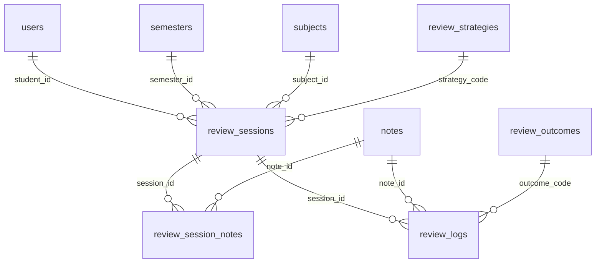

# SproutMemo 「我要复习」功能设计与开发规范

本文档详尽总结了本项目中“我要复习”模块（原“每日随机抽题复习”）的业务需求、设计理念、数据库关系架构、后端抽题逻辑与前端沉浸式交互的核心实现，以便作为后续多端维护及二次开发的标准规范。

---

## 1. 业务需求总结

本功能旨在解决学生日常练习中，缺乏高效、有针对性且轻量级复习策略的问题。全站标题由“每日随机抽题复习”统一更名为“我要复习”。

### 1.1 场景定义：场景 B（沉浸式重做）
- **复习形态**：学生自己点开题目，在纸上进行手写练习，无需在系统上输入答案。
- **打卡回单强校验**：完成练习后，学生在 Web 端点击“完成”按钮，系统弹出自定义模态对话框，强制进行打卡反馈。
- **强规则校验项**：
  1. 必须选择复习结果：`太简单了！` / `又做错了` / `照样不会`；
  2. 支持就地修改本题难度星级（1-5 星）；
  3. 支持就地修改掌握程度（未掌握 / 略微掌握 / 基本掌握 / 熟练掌握）；
  4. 支持就地一键将本题“移出复习库”。

### 1.2 页面关系：“我要复习”多页签聚合页面
- **🎯 开始复习页签**：负责筛选、拉取大纲预览、开启答题和沉浸式做题交互。
- **📋 复习历史页签**：负责分页查看历史任务、展开会话详细题目打卡用时与结果、呼出模态框高清预览错题图片与当时掌握度对比。

### 1.3 前端空间收缩与联动筛选
- **级联筛选**：增设“学习阶段”下拉菜单，与其子表“学期”建立级联联动过滤。
- **自收缩折叠**：当复习会话正式启动后，Header 收缩为高度仅为 `38px` 的窄行状态栏，隐藏无关选择器，释放 95% 垂直屏幕空间给“单题沉浸卡片”。
- **气泡提示 (Tooltip)**：
  - 题量档位下拉项仅展示雅致名称（如：稳扎稳打），鼠标悬停在其父控件时浮现 CSS 提示气泡（如：`复习量: 5 题`）；
  - 筛题策略下拉项仅展示策略名（如：艾宾浩斯），悬停时浮出说明气泡（如：`根据复习时间与掌握度动态计算遗忘权重`）。

### 1.4 延迟会话创建与刷新状态找回
- **延迟创建**：点击“生成复习”后首先发起 `/preview` 仅拉取列表展示大纲，**此时不在数据库记录会话**。学生点击“开始答题”时，前端把题目 `note_ids` 一并传递给 `POST /session` 接口，才在数据库建立持久化 ReviewSession。
- **刷新恢复**：加载页面时，前端调用 `/active-sessions` 检查是否存在 `IN_PROGRESS` 会话：
  - 若存在，弹出**自定义确认 Modal**（不使用原生 `confirm`，满足 `AGENTS.md` 对网页弹窗的红线要求）；
  - 用户确认后，拉取该会话并结合 `completed_count` 自动恢复到对应序号的卡片中，并显示剩余未答题目。

### 1.5 四大智能筛题策略
1. **听天由命（RANDOM）**：纯随机，在未排除复习的习题范围内随机抽取规定题量。
2. **艾宾浩斯遗忘曲线（EBBINGHAUS）**：
   - 过滤已排除复习的习题，依据习题的“掌握程度”和“上次复习时间”计算遗忘率并降序抽题。
3. **自我挑战（CHALLENGE）**：仅抽取难度在 `4星及以上` 且掌握程度排除“熟练掌握（MASTERED）”的习题。
4. **屡败屡战（PERSISTENT_FAILURE）**：优先抽取在历史复习日志中总是做错且没有任何做对记录的题目。

---

## 2. 数据库关系设计

物理表严格符合工业化关系型完整性标准，避免硬编码。

### 2.1 物理维度表与实体表
- **`review_strategies` (复习策略表)**：存储策略代码与其说明。
- **`review_count_presets` (题量档位表)**：存储复习题量选项（3题、5题、8题、10题）。
- **`review_outcomes` (复习反馈结果表)**：存储打卡选项（太简单了、又做错了、照样不会）及其对应的建议掌握度和配色 Hex。
- **`review_sessions` (复习会话表)**：记录每一次复习动作的主表。
- **`review_session_notes` (会话题目关联表)**：**【NEW】** 记录此会话包含哪些题目，以及题目展示顺序。支持学生即使中途刷新或断线重新加载页面，也能按原本顺序显示题目大纲并按序答题。
- **`review_logs` (复习打卡明细日志表)**：记录单题复习用时、打卡结果、前后的掌握度/难度变动快照。



---

## 3. 后端核心代码实现

### 3.1 会话题目关联模型与关系
在 [sproutmemo-api/app/models/review.py](file:///e:/home/lyc/Documents/code/SproutMemo/sproutmemo-api/app/models/review.py) 中，`ReviewSessionNote` 模型声明如下：

```python
class ReviewSessionNote(Base):
    """复习会话与题目关联明细表"""
    __tablename__ = "review_session_notes"

    id: Mapped[uuid.UUID] = mapped_column(
        Uuid, primary_key=True, default=uuid.uuid4
    )
    session_id: Mapped[uuid.UUID] = mapped_column(
        Uuid, ForeignKey("review_sessions.id", ondelete="CASCADE"), nullable=False, index=True
    )
    note_id: Mapped[uuid.UUID] = mapped_column(
        Uuid, ForeignKey("notes.id", ondelete="CASCADE"), nullable=False, index=True
    )
    sort_order: Mapped[int] = mapped_column(Integer, nullable=False, default=0)

    # Relationships
    session: Mapped["ReviewSession"] = relationship("ReviewSession", back_populates="session_notes")
    note: Mapped["Note"] = relationship("Note")
```

### 3.2 延迟会话创建与题目预览 API
在 [sproutmemo-api/app/api/v1/review.py](file:///e:/home/lyc/Documents/code/SproutMemo/sproutmemo-api/app/api/v1/review.py) 中，相关核心 API 实现：

```python
@router.get("/preview", response_model=dict)
def preview_review_notes(
    semester_id: uuid.UUID = Query(...),
    subject_id: uuid.UUID = Query(None),
    unit_code: int = Query(None),
    strategy_code: str = Query("EBBINGHAUS"),
    count_preset_code: str = Query("PRESET_5"),
    student_id: uuid.UUID = Query(None),
    db: Session = Depends(get_db),
    current_user: User = Depends(get_current_user)
):
    """仅生成复习的题目预览列表，不在数据库记录会话"""
    target_student_id = current_user.id
    if current_user.role == "PARENT":
        if not student_id:
            raise HTTPException(status_code=400, detail="家长身份预览复习会话必须指定 student_id")
        target_student_id = student_id

    preset = db.query(ReviewCountPreset).filter(ReviewCountPreset.code == count_preset_code).first()
    target_count = preset.count_value if preset else 5

    notes = get_review_notes(
        db=db,
        student_id=target_student_id,
        semester_id=semester_id,
        subject_id=subject_id,
        unit_code=unit_code,
        strategy_code=strategy_code,
        target_count=target_count
    )
    # 返回 NoteOut schema list...
```

---

## 4. 前端核心交互实现

### 4.1 级联学期联动过滤与 Tooltip 实现
在 [sproutmemo-web/src/components/ReviewFilterHeader.vue](file:///e:/home/lyc/Documents/code/SproutMemo/sproutmemo-web/src/components/ReviewFilterHeader.vue) 中，学习阶段联动和纯 CSS 提示气泡的实现方式：

```html
<!-- 题量档位 (Count Preset) 带悬浮气泡 -->
<div class="filter-item tooltip-box" :data-tooltip="countPresetTooltip">
  <label>题量档位</label>
  <select v-model="form.countPresetCode">
    <option v-for="p in presets.count_presets" :key="p.code" :value="p.code">
      {{ getPresetShowName(p) }}
    </option>
  </select>
</div>
```

```css
/* 纯 CSS 气泡提示 Tooltip 实现 */
.tooltip-box {
  position: relative;
}
.tooltip-box::after {
  content: attr(data-tooltip);
  position: absolute;
  bottom: 125%;
  left: 50%;
  transform: translateX(-50%);
  background: #1e293b;
  color: #ffffff;
  padding: 6px 12px;
  border-radius: 6px;
  font-size: 11px;
  white-space: nowrap;
  opacity: 0;
  pointer-events: none;
  transition: opacity 0.2s ease, transform 0.2s ease;
  z-index: 100;
  box-shadow: 0 4px 12px rgba(0, 0, 0, 0.15);
  border: 1px solid rgba(255, 255, 255, 0.1);
}
.tooltip-box:hover::after {
  opacity: 1;
  transform: translateX(-50%) translateY(-2px);
}
```

### 4.2 正在进行会话检测与自定义 Modal
在 [sproutmemo-web/src/views/DailyReview.vue](file:///e:/home/lyc/Documents/code/SproutMemo/sproutmemo-web/src/views/DailyReview.vue) 中，使用自定义 Modal（禁止 `confirm`）的断点继续答题实现：

```html
<div v-if="showResumeModal" class="custom-modal-overlay">
  <div class="custom-modal-card">
    <div class="modal-icon">💡</div>
    <h3>发现未完成的复习任务</h3>
    <p>系统检测到您上次有未完成的“我要复习”进度，是否继续答题？</p>
    <div class="modal-actions">
      <button class="btn-confirm" @click="resumeActiveSession">继续复习</button>
      <button class="btn-cancel" @click="abandonActiveSession">放弃并重新抽题</button>
    </div>
  </div>
</div>
```

---

## 5. 开发验证与部署策略

### 5.1 部署流程 (186 服务器)
本系统在 `192.168.7.186` 服务器部署，严格执行容器化和持久化隔离标准。
- **持久化映射**：
  - 后端存储：`/opt/docker/SproutMemo/backend/pgdata` (PostgreSQL) 与 `/opt/docker/SproutMemo/backend/data` (附件)；
  - 前端静态页目录：`/opt/docker/SproutMemo/web`。
- **自动迁移脚本**：Alembic 升级通过 `docker exec sproutmemo-backend alembic upgrade head` 在容器内执行。包含将 down_revision 设置为 `202607310001` 的最新 DDL 变动。

### 5.2 验证方案
每次更新后必须运行后端单元测试套件：
```bash
set PYTHONPATH=.
venv\Scripts\pytest app\tests\test_review.py
```
只有当单元测试全部通过且前端构建成功无任何错误（`npm run build`）后，方可运行 `python deploy.py` 进行远程部署发布。
